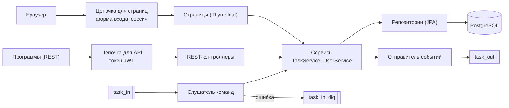
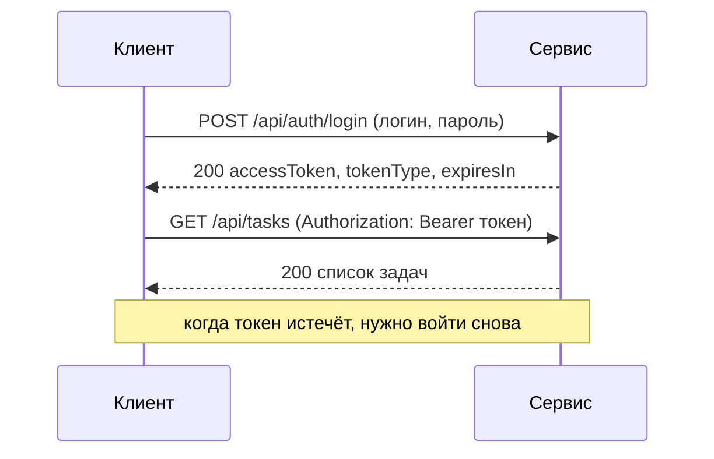
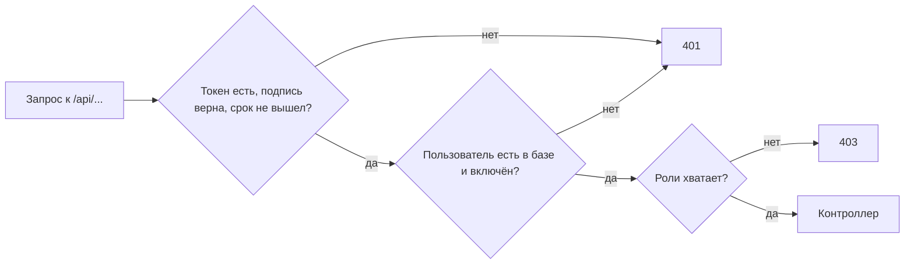
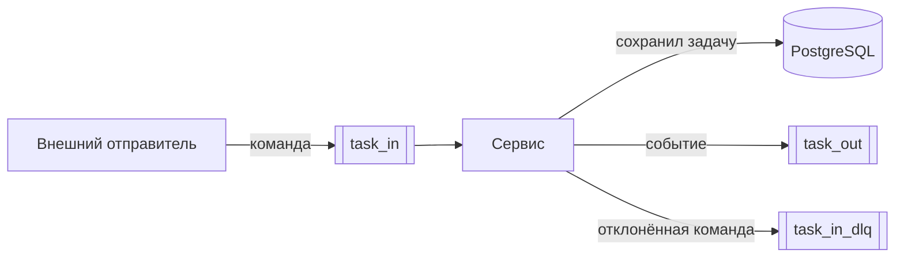
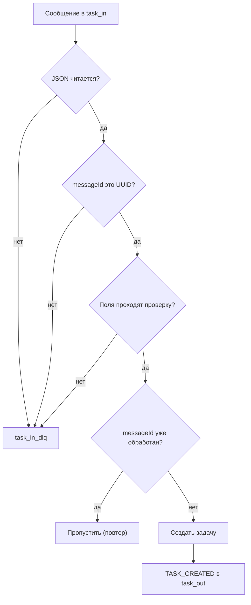

# task-api-service

Учебный сервис управления задачами (интерфейс «Task Lab»): REST API и веб-страницы, хранение в PostgreSQL, обмен сообщениями через Kafka, авторизация по ролям. Проект учебный: на нём отрабатываются приёмы разработки сервиса и его проверки. Автотесты лежат в отдельном репозитории [task-api-tests](https://github.com/ArtemKarDev/task-api-tests).

## Оглавление

- [Что это](#что-это)
- [Возможности](#возможности)
- [Стек](#стек)
- [Архитектура](#архитектура)
- [Быстрый старт](#быстрый-старт)
- [Веб-страницы](#веб-страницы)
- [REST API](#rest-api)
    - [Задачи](#задачи)
    - [Формат ошибок](#формат-ошибок)
    - [Swagger](#swagger)
- [Авторизация](#авторизация)
    - [Как войти](#как-войти)
    - [Роли и доступ](#роли-и-доступ)
    - [Пароли и пользователи](#пароли-и-пользователи)
    - [Ограничения безопасности](#ограничения-безопасности)
- [Kafka](#kafka)
    - [Топики](#топики)
    - [События задач](#события-задач)
    - [Команды](#команды)
    - [Попробовать вручную](#попробовать-вручную)
- [Запуск стендов в Docker](#запуск-стендов-в-docker)

---

## Что это

Сервис работает с одной сущностью: **задача** (`Task`).

| Поле | Правила |
|---|---|
| `title` | название, обязательное, до 255 символов |
| `description` | описание, необязательное, до 5000 символов |
| `status` | статус, обязательный: `NEW`, `IN_PROGRESS`, `DONE` |
| `priority` | приоритет, обязательный: `LOW`, `MEDIUM`, `HIGH` |
| `assignee` | исполнитель, необязательный, до 100 символов |

Пустое описание и пустой исполнитель сохраняются как «не задано». Идентификатор и времена создания и изменения назначает сервис.

<p align="right"><a href="#оглавление">↑ к оглавлению</a></p>

---

## Возможности

- **Веб-интерфейс**: список и поиск задач (по названию, описанию и исполнителю, с фильтром по статусу), создание, изменение, удаление (только администратор), вход и выход, смена своего пароля, страница «О проекте».
- **REST API**: получение списка и одной задачи, создание, полная и частичная правка, удаление; единый формат ошибок; описание в Swagger UI.
- **Kafka**: сервис пишет события об изменениях задач в топик `task_out` и создаёт задачи по командам из топика `task_in`; некорректные команды уходят в `task_in_dlq`.
- **Авторизация**: вход по токену (JWT) для API, вход через форму с сессией для страниц; роли `USER` и `ADMIN`; администратор управляет пользователями.
- **Данные**: PostgreSQL, схему создаёт и меняет Flyway.
- **Запуск**: стенды `local`, `dev`, `stage` в Docker, автоматическое развёртывание и проверки в Jenkins.

<p align="right"><a href="#оглавление">↑ к оглавлению</a></p>

---

## Стек

| Что | Чем |
|---|---|
| Язык и платформа | Java 21, Spring Boot 4.1 |
| Веб | Spring MVC, Thymeleaf |
| Данные | Spring Data JPA (Hibernate), PostgreSQL 17, Flyway |
| Безопасность | Spring Security 7: сервер ресурсов JWT (API), вход через форму и сессии (страницы) |
| Сообщения | Spring for Apache Kafka (брокер apache/kafka 4.2 в режиме KRaft) |
| Документация API | springdoc-openapi (Swagger UI) |
| Прочее | Lombok, Actuator (наружу открыт только `health`) |
| Запуск | Docker и Docker Compose, Jenkins |

<p align="right"><a href="#оглавление">↑ к оглавлению</a></p>

---

## Архитектура

У сервиса два «входа» с разной защитой: страницы для людей и REST для программ. Оба приводят к одним и тем же сервисам и данным.



### Структура кода

Пакет `ru.learning.taskapiservice`:

| Пакет | Что внутри |
|---|---|
| `config` | описание API для Swagger (`OpenApiConfig`), журнал HTTP-запросов (`HttpLoggingFilter`) |
| `controller` | страницы: `StaticPageController`, `TaskPageController`, `ProfileController`; REST: `TaskController`, `AuthController`, `CurrentUserController`, `AdminUserController` |
| `dto` | запросы, ответы и формы, перечисления `Priority` и `TaskStatus`, единый формат ошибки `ApiErrorResponse` |
| `entity` | `Task`, `UserAccount`, `Role`, `ProcessedMessage` (обработанные сообщения Kafka) |
| `exceptions` | исключения и обработчики ошибок (`GlobalExceptionHandler` для REST, `ApiRoutingExceptionHandler` для неизвестных адресов API) |
| `kafka` | топики, события, команды, слушатель команд, отправители событий и отклонённых сообщений |
| `repository` | интерфейсы Spring Data JPA |
| `security` | цепочки безопасности, выдача и проверка токенов, загрузка пользователей |
| `service` | `TaskService`, `UserService`, `AuthService` |

<p align="right"><a href="#оглавление">↑ к оглавлению</a></p>

---
## Веб-страницы

Все страницы, кроме страницы входа, требуют входа через форму. Без входа браузер перенаправляется на `/login`.

| Адрес | Что это | Кто может |
|---|---|---|
| `/` | перенаправляет на `/tasks` | вошедший |
| `/login` | форма входа (`POST /login` отправляет её) | все |
| `/logout` | выход (только методом `POST`, форма в шапке) | вошедший |
| `/tasks` | список и поиск задач: параметр `q` (по названию, описанию и исполнителю) и `status` (фильтр по статусу) | вошедший |
| `/tasks/new` | форма создания задачи (`POST /tasks`) | вошедший |
| `/tasks/{id}/edit` | форма изменения (`POST /tasks/{id}`) | вошедший |
| `/tasks/{id}/delete` | удаление, только методом `POST` (кнопка в списке) | **только `ADMIN`**; у `USER` кнопки нет, а запрос получит 403 |
| `/profile/password` | смена своего пароля | вошедший |
| `/about` | страница «О проекте» | вошедший |

Страницы используют защиту форм (CSRF): токен подставляется в каждую форму автоматически.

<p align="right"><a href="#оглавление">↑ к оглавлению</a></p>

---

## REST API

Адреса под `/api/`. Кроме `POST /api/auth/login`, все требуют токен в заголовке `Authorization: Bearer <токен>`; как его получить, описано в разделе про авторизацию. Тела запросов и ответов в формате JSON. Лишние поля в запросе не игнорируются, а отклоняются (400).

### Задачи

| Метод и адрес | Что делает | Успех | Ошибки |
|---|---|---|---|
| `GET /api/tasks` | все задачи (фильтров и постраничного вывода пока нет) | 200 | 401 |
| `GET /api/tasks/{id}` | одна задача | 200 | 400 (идентификатор не число), 401, 404 |
| `POST /api/tasks` | создать задачу | 201 и созданная задача | 400, 401 |
| `PUT /api/tasks/{id}` | заменить задачу целиком; необязательные поля, которых нет в запросе или которые пустые, очищаются | 200 | 400, 401, 404 |
| `PATCH /api/tasks/{id}` | изменить только указанные поля; очистить поле через `PATCH` нельзя (для этого `PUT`); хотя бы одно поле обязательно | 200 | 400, 401, 404 |
| `DELETE /api/tasks/{id}` | удалить задачу | 204 | 400, 401, **403** (только `ADMIN`), 404 |

Пример (PowerShell):

```powershell
$base = "http://localhost:8080"
$login = Invoke-RestMethod -Method Post -Uri "$base/api/auth/login" -ContentType "application/json" -Body (@{ username = "user"; password = "<пароль>" } | ConvertTo-Json)
$h = @{ Authorization = "Bearer $($login.accessToken)" }

# создать
Invoke-RestMethod -Method Post -Uri "$base/api/tasks" -Headers $h -ContentType "application/json" -Body '{"title":"Prepare report","status":"NEW","priority":"HIGH"}'

# прочитать
Invoke-RestMethod -Uri "$base/api/tasks/1" -Headers $h
```

Поля задачи и их правила описаны в разделе «Что это».

### Формат ошибок

Все ошибки API имеют одинаковую форму:

```json
{
  "timestamp": "2026-11-05T12:40:00.123Z",
  "status": 400,
  "error": "Bad Request",
  "message": "Validation failed",
  "details": [ { "field": "title", "message": "must not be blank" } ],
  "path": "/api/tasks"
}
```

| Код | Когда | `message` |
|---|---|---|
| 400 | не прошла проверка полей | `Validation failed` (подробности в `details`: `must not be blank`, `must not exceed N characters`, `must not be null`) |
| 400 | битый JSON, пустое тело, неверное значение перечисления, неизвестное поле | `Request body is missing, malformed or contains an invalid value` |
| 400 | параметр адреса не того типа (`/api/tasks/abc`) | `Invalid request parameter` |
| 400 | `PATCH` без полей | `At least one field must be provided` |
| 401 | нет токена или он неверен или просрочен | `Authentication required` или `Invalid or expired token` |
| 403 | вошёл, но роли не хватает | `Access denied: insufficient permissions` |
| 404 | нет такой задачи или неизвестный адрес | сообщение о ненайденной задаче или `Resource not found` |
| 405 | метод не поддерживается адресом | заголовок `Allow` перечисляет допустимые методы |
| 409 | нарушение целостности данных, занятый логин | `Data conflict…`, `Username already exists` |
| 500 | необработанная ошибка | `Internal server error` (подробности только в журнале, не в ответе) |

### Swagger

Описание API в Swagger UI: `http://localhost:8080/swagger-ui/index.html`, спецификация OpenAPI: `http://localhost:8080/v3/api-docs`. Оба адреса открыты без входа. Описание схемы безопасности (кнопка «Authorize») пока не добавлено: защищённые методы из Swagger UI без токена вернут 401.

<p align="right"><a href="#оглавление">↑ к оглавлению</a></p>

---

## Авторизация

Страницы и REST API защищены по-разному: людям удобна форма входа с сессией, программам токен.

### Как войти

**REST API: токен.** Войти можно запросом `POST /api/auth/login` с логином и паролем. В ответ приходит токен, который прикладывают к каждому следующему запросу.



Ответ на вход:

```json
{ "accessToken": "eyJ…", "tokenType": "Bearer", "expiresIn": 900 }
```

| Свойство токена | Значение |
|---|---|
| Формат | JWT, подпись HS256 общим секретом (`APP_SECURITY_JWT_SECRET`, не короче 32 байт) |
| Срок жизни | 15 минут (`expiresIn` в секундах), настройка `app.security.jwt.ttl-minutes` |
| Содержимое | логин (`sub`), роль (`role`, справочно), время выдачи и окончания |
| Продление | не предусмотрено: после истечения нужно войти заново |

При неверном логине, неверном пароле и отключённом пользователе ответ один и тот же (`401 Invalid username or password`): снаружи нельзя узнать, какой логин существует.

**Что происходит на каждом запросе к API.** Сначала проверяются подпись и срок токена, затем сервис **сверяется с базой**: пользователь должен существовать и быть включённым, а роль берётся из базы (а не из токена). Поэтому отключение пользователя, удаление и смена роли действуют сразу, не дожидаясь окончания токена.



**Страницы: форма и сессия.** Форма входа `/login`; после успеха браузер получает cookie сессии. Имя cookie на стендах `dev` и `stage` разное (`TASKSESSION_<порт приложения>`), чтобы вход на одном стенде не «выбрасывал» с другого в браузере (cookie общие для всех портов `localhost`). Выход выполняется кнопкой «Выйти» в шапке (запрос `POST /logout`); формы защищены токеном CSRF.

### Роли и доступ

Две роли: `USER` (работает с задачами и со своим паролем) и `ADMIN` (кроме того, удаляет задачи и управляет пользователями).

| Адрес | Аноним | `USER` | `ADMIN` |
|---|---|---|---|
| `/actuator/health`, Swagger UI, `/v3/api-docs`, `/login`, `POST /api/auth/login` | доступно | доступно | доступно |
| `GET, POST, PUT, PATCH /api/tasks…` | 401 | доступно | доступно |
| `DELETE /api/tasks/{id}` | 401 | 403 | доступно |
| `PUT /api/users/me/password` | 401 | доступно | доступно |
| `/api/admin/users…` | 401 | 403 | доступно |
| Страницы (`/tasks`, `/tasks/new`, `/tasks/{id}/edit`, `/about`, `/profile/password`) | на вход | доступно | доступно |
| `POST /tasks/{id}/delete` | на вход | 403 | доступно |

В интерфейсе у `USER` кнопки «Удалить» нет вовсе, а запрос удаления, отправленный вручную, получит 403: защита стоит на сервере, а не только в разметке страницы. Вместо серой технической страницы при 403 показывается страница «Недостаточно прав».

### Пароли и пользователи

**Хранение.** Пароли нигде не хранятся в открытом виде, только хеши BCrypt. Пароль не должен быть короче 8 символов и длиннее 72 байт (BCrypt учитывает не больше 72 байт, а русские буквы занимают по 2 байта).

**Загрузочные пользователи.** При каждом старте сервис создаёт, если их нет, двух пользователей: `user` (роль `USER`) и `admin` (роль `ADMIN`); пароли берутся из переменных окружения `APP_SECURITY_USER_PASSWORD` и `APP_SECURITY_ADMIN_PASSWORD`. Если значение в настройках изменили, при следующем старте пароль в базе обновится: для этих двух учётных записей источник правды настройки (смена пароля через интерфейс при перезапуске будет возвращена). Без этих переменных и без `APP_SECURITY_JWT_SECRET` сервис не запускается.

**Смена своего пароля.** Страница `/profile/password` (ссылка на имя пользователя в шапке) или `PUT /api/users/me/password` с телом `{"currentPassword": "…", "newPassword": "…"}` (ответ `204`). Нужно указать верный текущий пароль, новый должен отличаться от него.

**Управление пользователями (только `ADMIN`).**

| Запрос | Что делает | Успех | Ошибки |
|---|---|---|---|
| `POST /api/admin/users` | создать: `{"username", "password", "role"}`; логин 3-50 символов из латинских букв, цифр, `.`, `_`, `-` | 201 и пользователь без пароля | 400, 409 (логин занят) |
| `GET /api/admin/users` | список пользователей | 200 | |
| `PATCH /api/admin/users/{id}` | включить или отключить, сменить роль: `{"enabled"?, "role"?}`, хотя бы одно поле | 200 | 400, 404 |
| `PUT /api/admin/users/{id}/password` | сбросить пароль: `{"newPassword"}` | 204 | 400, 404 |
| `DELETE /api/admin/users/{id}` | удалить пользователя | 204 | 400, 404 |

Защита от случайной блокировки: администратор **не может отключить, понизить или удалить самого себя** (ответ 400). Самостоятельной регистрации нет: пользователей создаёт администратор.

### Ограничения безопасности

Это учебный проект, и у него есть сознательные допущения:

- **Смена пароля не отзывает уже выданные токены** (они действуют до окончания срока, 15 минут). Отключение, удаление и смена роли действуют сразу.
- **Открытая сессия на страницах** отключённого пользователя продолжает работать до выхода или истечения сессии (проверка по базе на каждом запросе сделана только для API).
- **Журнал HTTP-запросов** (включён на стендах) записывает тела запросов и ответов, в том числе пароли и токены: так удобно разбирать работу сервиса. В реальной системе секреты в журналах маскируют.
- **HTTPS на стендах нет**: трафик не выходит за пределы компьютера. В реальной системе передача только по HTTPS обязательна.
- **Нет защиты от подбора паролей** (ограничения числа попыток), нет самостоятельной регистрации и продления токенов.
- Учебные пароли и секрет стенда `local` лежат в открытом виде в шаблонах и примерах. Значения для `dev` и `stage` хранятся только в файлах окружения и в секретных файлах Jenkins.

<p align="right"><a href="#оглавление">↑ к оглавлению</a></p>

---

## Kafka

Сервис работает с Kafka в двух направлениях: **пишет события** об изменениях задач и **читает команды** на создание задач. Брокер запускается в Docker вместе со стендом (режим KRaft, без отдельного ZooKeeper).



### Топики

| Топик | Назначение | Кто пишет | Кто читает |
|---|---|---|---|
| `task_in` | команды «создать задачу» | внешний отправитель | сервис |
| `task_out` | события `TASK_CREATED`, `TASK_UPDATED`, `TASK_DELETED` | сервис | внешние потребители |
| `task_in_dlq` | команды, которые сервис отклонил (с причиной) | сервис | внешние потребители |

Имена топиков заданы настройками `app.kafka.topic-in`, `app.kafka.topic-in-dlq`, `app.kafka.topic-out`. Топики создаёт сам сервис при старте (по одной партиции и одной реплике). Сервис читает `task_in` в группе `task-api-service` и при первом запуске группы начинает с начала топика, поэтому команды, отправленные до первого старта, не теряются.

### События задач

Событие отправляется при **любом** изменении задачи (из интерфейса, REST или команды Kafka) после того, как оно сохранено в базе. Ключ сообщения: номер задачи, поэтому события одной задачи приходят в порядке изменений.

```json
{
  "eventId": "7b0c4a6e-…",
  "eventType": "TASK_CREATED",
  "occurredAt": "2026-11-05T12:40:00.123Z",
  "correlationId": "…",
  "taskId": 42,
  "task": { "…": "снимок задачи на момент события" }
}
```

| Поле | Что это |
|---|---|
| `eventId` | уникальный идентификатор события |
| `eventType` | `TASK_CREATED`, `TASK_UPDATED` или `TASK_DELETED` |
| `occurredAt` | время события в UTC |
| `correlationId` | связывает событие с его причиной (для задач, созданных командой Kafka, это идентификатор сообщения) |
| `taskId` | номер задачи |
| `task` | снимок полей задачи |

Отправка идёт асинхронно: событие может прийти с небольшой задержкой. Если брокер недоступен, отправка ждёт не больше 3 секунд, после чего событие записывается в журнал как потерянное: повторных попыток и надёжной доставки (паттерн outbox) пока нет.

### Команды

Команда «создать задачу» приходит в `task_in` в виде JSON:

```json
{
  "messageId": "2f6c1b7e-3d0a-4c3e-9a55-6c2a1f0d8b11",
  "title": "Prepare report",
  "description": "optional",
  "status": "NEW",
  "priority": "HIGH",
  "assignee": "optional"
}
```

Правила те же, что у REST (обязательны `title`, `status`, `priority`; те же пределы длины). Дополнительно:

- `messageId` обязателен и должен быть UUID. Это ключ идемпотентности: **повторная команда с тем же `messageId` создаёт задачу только один раз**.
- Лишние поля в JSON и значения вне допустимого списка отклоняются.

Каждое сообщение проходит четыре проверки по порядку (схема ниже); первая неудача останавливает обработку.



Причины, с которыми сообщение попадает в `task_in_dlq`:

| Причина | Текст |
|---|---|
| не JSON, лишнее поле или недопустимое значение | `Message is not valid JSON or contains unknown fields or invalid values` |
| нет `messageId` или он не UUID | `messageId is missing or is not a UUID` |
| не прошла проверка полей | `Validation failed: <поле>: <сообщение>; …` (поля по алфавиту) |

### Попробовать вручную

Адреса брокера: из контейнеров `kafka:29092` (внутренний), с вашего компьютера `localhost:<порт>`: `9092` для `local`, `9192` для `dev`, `9292` для `stage`. Для просмотра можно поднять Kafka UI (профиль `tools` в `compose.yaml`; порты 8090, 8190, 8290 для `local`, `dev`, `stage`).

Отправить команду консольной утилитой (в сообщении используйте латинские буквы: русские в консоли Windows портятся):

```powershell
docker compose --env-file env/dev.env exec kafka /opt/kafka/bin/kafka-console-producer.sh --bootstrap-server kafka:29092 --topic task_in
```

Вставьте одну строку JSON команды (см. выше) и нажмите `Enter`, затем `Ctrl+C`. Прочитать события:

```powershell
docker compose --env-file env/dev.env exec kafka /opt/kafka/bin/kafka-console-consumer.sh --bootstrap-server kafka:29092 --topic task_out --from-beginning
```

<p align="right"><a href="#оглавление">↑ к оглавлению</a></p>

---

## Быстрый старт

Нужны: JDK 21, Docker Desktop, IDE (например, IntelliJ IDEA). Стенд `local`: база и Kafka работают в Docker, сам сервис запускается из IDE.

1. Подготовьте файл настроек стенда (один раз) и запустите базу и Kafka:

```powershell
Copy-Item env\local.env.example env\local.env
docker compose --env-file env/local.env up -d postgres kafka
```

2. Запустите класс `TaskApiServiceApplication` из IDE, добавив в настройки запуска переменные окружения (значения учебные):

```
APP_SECURITY_USER_PASSWORD=local_user_password
APP_SECURITY_ADMIN_PASSWORD=local_admin_password
APP_SECURITY_JWT_SECRET=local-dev-jwt-secret-0123456789abcdef
```

Без этих трёх переменных сервис не запустится (сделано намеренно: нельзя случайно запустить его с пустыми паролями). Адреса базы (`localhost:5433`) и Kafka (`localhost:9092`) по умолчанию уже подходят для стенда `local`.

3. Откройте `http://localhost:8080/`: откроется форма входа. Войдите как `user` или `admin` (пароли из пункта 2).

Полезные адреса: Swagger UI `http://localhost:8080/swagger-ui/index.html`, проверка работоспособности `http://localhost:8080/actuator/health`.

<p align="right"><a href="#оглавление">↑ к оглавлению</a></p>

---