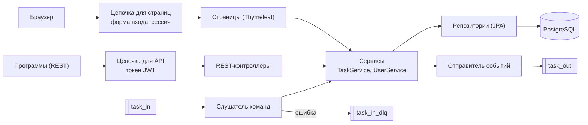

# task-api-service

Учебный сервис управления задачами (интерфейс «Task Lab»): REST API и веб-страницы, хранение в PostgreSQL, обмен сообщениями через Kafka, авторизация по ролям. Проект учебный: на нём отрабатываются приёмы разработки сервиса и его проверки. Автотесты лежат в отдельном репозитории [task-api-tests](https://github.com/ArtemKarDev/task-api-tests).

## Оглавление

- [Что это](#что-это)
- [Возможности](#возможности)
- [Стек](#стек)
- [Архитектура](#архитектура)
- [Быстрый старт](#быстрый-старт)
- [Запуск стендов в Docker](#запуск-стендов-в-docker)

---

## Что это

Сервис работает с одной сущностью: **задача** (`Task`).

| Поле | Правила |
|---|---|
| `title` | название, обязательное, до 255 символов |
| `description` | описание, необязательное, до 5000 символов |
| `status` | статус, обязательный: `NEW`, `IN_PROGRESS`, `DONE` |
| `priority` | приоритет, обязательный: `LOW`, `MEDIUM`, `HIGH` |
| `assignee` | исполнитель, необязательный, до 100 символов |

Пустое описание и пустой исполнитель сохраняются как «не задано». Идентификатор и времена создания и изменения назначает сервис.

<p align="right"><a href="#оглавление">↑ к оглавлению</a></p>

---

## Возможности

- **Веб-интерфейс**: список и поиск задач (по названию, описанию и исполнителю, с фильтром по статусу), создание, изменение, удаление (только администратор), вход и выход, смена своего пароля, страница «О проекте».
- **REST API**: получение списка и одной задачи, создание, полная и частичная правка, удаление; единый формат ошибок; описание в Swagger UI.
- **Kafka**: сервис пишет события об изменениях задач в топик `task_out` и создаёт задачи по командам из топика `task_in`; некорректные команды уходят в `task_in_dlq`.
- **Авторизация**: вход по токену (JWT) для API, вход через форму с сессией для страниц; роли `USER` и `ADMIN`; администратор управляет пользователями.
- **Данные**: PostgreSQL, схему создаёт и меняет Flyway.
- **Запуск**: стенды `local`, `dev`, `stage` в Docker, автоматическое развёртывание и проверки в Jenkins.

<p align="right"><a href="#оглавление">↑ к оглавлению</a></p>

---

## Стек

| Что | Чем |
|---|---|
| Язык и платформа | Java 21, Spring Boot 4.1 |
| Веб | Spring MVC, Thymeleaf |
| Данные | Spring Data JPA (Hibernate), PostgreSQL 17, Flyway |
| Безопасность | Spring Security 7: сервер ресурсов JWT (API), вход через форму и сессии (страницы) |
| Сообщения | Spring for Apache Kafka (брокер apache/kafka 4.2 в режиме KRaft) |
| Документация API | springdoc-openapi (Swagger UI) |
| Прочее | Lombok, Actuator (наружу открыт только `health`) |
| Запуск | Docker и Docker Compose, Jenkins |

<p align="right"><a href="#оглавление">↑ к оглавлению</a></p>

---

## Архитектура

У сервиса два «входа» с разной защитой: страницы для людей и REST для программ. Оба приводят к одним и тем же сервисам и данным.



### Структура кода

Пакет `ru.learning.taskapiservice`:

| Пакет | Что внутри |
|---|---|
| `config` | описание API для Swagger (`OpenApiConfig`), журнал HTTP-запросов (`HttpLoggingFilter`) |
| `controller` | страницы: `StaticPageController`, `TaskPageController`, `ProfileController`; REST: `TaskController`, `AuthController`, `CurrentUserController`, `AdminUserController` |
| `dto` | запросы, ответы и формы, перечисления `Priority` и `TaskStatus`, единый формат ошибки `ApiErrorResponse` |
| `entity` | `Task`, `UserAccount`, `Role`, `ProcessedMessage` (обработанные сообщения Kafka) |
| `exceptions` | исключения и обработчики ошибок (`GlobalExceptionHandler` для REST, `ApiRoutingExceptionHandler` для неизвестных адресов API) |
| `kafka` | топики, события, команды, слушатель команд, отправители событий и отклонённых сообщений |
| `repository` | интерфейсы Spring Data JPA |
| `security` | цепочки безопасности, выдача и проверка токенов, загрузка пользователей |
| `service` | `TaskService`, `UserService`, `AuthService` |

<p align="right"><a href="#оглавление">↑ к оглавлению</a></p>

---

## Быстрый старт

Нужны: JDK 21, Docker Desktop, IDE (например, IntelliJ IDEA). Стенд `local`: база и Kafka работают в Docker, сам сервис запускается из IDE.

1. Подготовьте файл настроек стенда (один раз) и запустите базу и Kafka:

```powershell
Copy-Item env\local.env.example env\local.env
docker compose --env-file env/local.env up -d postgres kafka
```

2. Запустите класс `TaskApiServiceApplication` из IDE, добавив в настройки запуска переменные окружения (значения учебные):

```
APP_SECURITY_USER_PASSWORD=local_user_password
APP_SECURITY_ADMIN_PASSWORD=local_admin_password
APP_SECURITY_JWT_SECRET=local-dev-jwt-secret-0123456789abcdef
```

Без этих трёх переменных сервис не запустится (сделано намеренно: нельзя случайно запустить его с пустыми паролями). Адреса базы (`localhost:5433`) и Kafka (`localhost:9092`) по умолчанию уже подходят для стенда `local`.

3. Откройте `http://localhost:8080/`: откроется форма входа. Войдите как `user` или `admin` (пароли из пункта 2).

Полезные адреса: Swagger UI `http://localhost:8080/swagger-ui/index.html`, проверка работоспособности `http://localhost:8080/actuator/health`.

<p align="right"><a href="#оглавление">↑ к оглавлению</a></p>

---